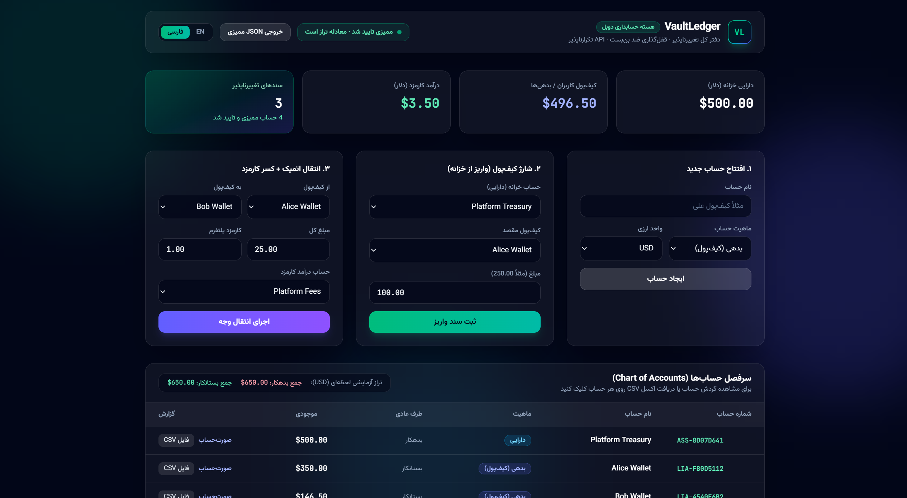
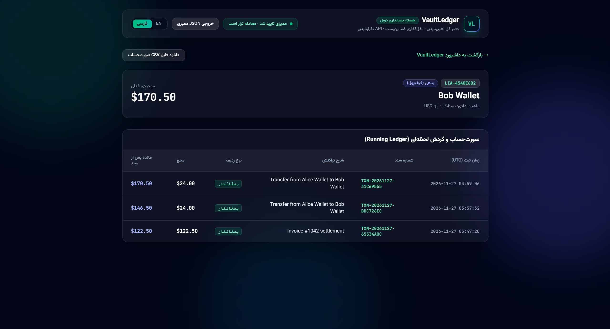

# VaultLedger

A fintech-grade **Double-Entry Financial Core Ledger** built with **Ruby 3.3**, **Ruby on Rails 8**, **Tailwind CSS**, and **RSpec** — engineered for strict financial invariants, zero-drift integer accounting, deadlock-free concurrency, and idempotent REST APIs.

## Why This Architecture Matters

Naive wallet apps mutate a single `balance` column directly, which breaks under concurrent requests, loses audit trails, and hides rounding errors. **VaultLedger** implements real accounting primitives:

- **Strict Double-Entry Invariant:** Every transaction must satisfy `sum(debits) == sum(credits)` across at least two legs. Globally, the ledger continuously enforces `Assets + Expenses = Liabilities + Equity + Revenue` per currency.
- **Append-Only Immutability:** `LedgerTransaction` and `LedgerEntry` records raise `LedgerErrors::ImmutableRecord` on update or deletion. Corrections are performed exclusively via exact inverse **Reversal Transactions** (guarded by a unique partial DB index to prevent double-reversals).
- **Zero-Float Integer Accounting (`MoneyAmount`):** All balances and entries are stored in integer minor units (cents). The pure-Ruby `MoneyAmount` value object explicitly rejects `Float` inputs to eliminate IEEE-754 precision bugs.
- **Deadlock-Free Pessimistic Locking:** `Ledger::PostTransaction` sorts target account IDs in ascending order before acquiring row-level locks inside an atomic database transaction, preventing both race-condition double-spending and circular deadlocks.
- **Database-Level Check Constraints:** Even outside Rails, DB check constraints forbid negative entry amounts, invalid account types, and negative wallet balances (unless `allow_negative` is explicitly enabled).
- **Idempotent REST API (`Idempotency-Key`):** Retried API requests replay the cached response with `X-Idempotent-Replayed: true` without moving funds twice. Reusing a key with a mismatched SHA-256 payload hash returns `409 Conflict`.
- **Automated Integrity Auditor (`Ledger::AuditIntegrity`):** Recomputes every account balance from its raw immutable journal entries to detect any out-of-band balance drift.

## Screenshots

### Financial Dashboard & Immutable Journal

### Account Statement (Running Ledger)

## Tech Stack

- **Language & Framework:** Ruby 3.3, Ruby on Rails 8
- **Testing:** RSpec (`rspec-rails`) with unit, service, immutability, integrity-audit, and API idempotency specs
- **Frontend:** ERB, Tailwind CSS v4
- **Code Quality & CI:** RuboCop Rails Omakase, GitHub Actions

## Local Setup

~~~bash
git clone https://github.com/ErfanMoosavian/vaultledger.git
cd vaultledger
bundle install
bin/rails db:prepare db:seed
bin/rails tailwindcss:build
bin/rails server
~~~

Open `http://localhost:3000` to explore the interactive ledger dashboard.

## Running Tests & Linter

~~~bash
bundle exec rspec --format documentation
bundle exec rubocop
~~~

## REST API Examples

**Execute an idempotent 3-leg transfer (with platform fee split):**
~~~bash
curl -X POST http://localhost:3000/api/v1/transfers \
  -H "Content-Type: application/json" \
  -H "Idempotency-Key: order-9921" \
  -d '{"from_account_id":2,"to_account_id":3,"amount_cents":2500,"fee_cents":100,"fee_account_id":4,"description":"Order #9921"}'
~~~

**Run a live global integrity audit:**
~~~bash
curl http://localhost:3000/api/v1/audit
~~~

## License

MIT
